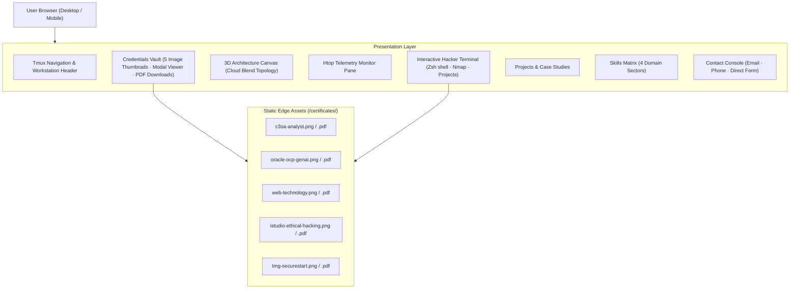

# System Architecture Document (ARCHITECHTURE.md)

## 1. High-Level Architecture
The application is structured as a modular React 19 single-page application built with Vite and Tailwind CSS, featuring an embedded Three.js WebGL graphics pipeline and static certificate asset delivery.

## 2. Certificate Asset Pipeline
- **Storage**: Placed inside `public/certificates/` for direct, high-speed static CDN delivery.
- **Formats**:
  - Web-optimized PNG (`sips` rendered) for instant in-browser modal inspection.
  - Authentic PDF files for download and offline verification.
- **Security & Integrity**: Zero external redirect vulnerabilities; all documents served from the local static root with clean MIME types.
